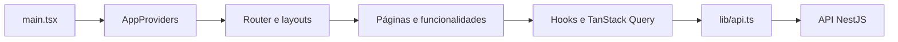

# Arquitetura do frontend

O Moment Web é uma SPA React com TypeScript e Vite. React Router controla navegação; TanStack Query guarda estado vindo da API; React Hook Form/Zod aparecem nos formulários. A interface usa CSS e estilos locais, com variáveis de tema. Requisições usam `fetch`, não Axios; não há Tailwind nas dependências atuais.

## Entrada e estrutura

| Local em `src/` | Responsabilidade |
| --- | --- |
| `main.tsx` | CSS global, React StrictMode, providers e router. |
| `app/providers.tsx` | QueryClient, tema e sincronização de sessão, idioma e fonte. |
| `app/router.tsx` | Árvore de rotas e composição de páginas. |
| `components/layout/` | Layout autenticado, navegação e proteção de rotas. |
| `components/ui/` | Elementos reutilizados, como imagens expandidas, logos e emojis. |
| `features/` | Funcionalidades, páginas, hooks, clientes HTTP e estilos. |
| `lib/api.ts`, `lib/query-client.ts` | Contrato de requisições, erros, renovação e política padrão de cache. |
| `contexts/`, `i18n/`, `assets/` | Tema, tradução e recursos visuais. |

Nem toda feature segue a mesma divisão: algumas usam `api/`, `hooks/` e `pages/`, outras concentram componentes e operações em arquivos como `chat.tsx` ou `stations-pages.tsx`. Procure a funcionalidade antes de criar estruturas paralelas.

## Navegação

| Grupo | Rotas principais |
| --- | --- |
| Público | `/terms`, `/privacy`, `/support`, `/forgot-password`, `/reset-password` |
| Entrada para visitantes | `/login`, `/register`, sob `GuestRoute` |
| Autenticado | `/`, `/posts/:id`, `/explore`, `/notifications`, `/profile`, `/profile/:username`, `/settings` |
| Estações | `/communities`, `/communities/:id`, `/communities/topics/:topicId` |
| Ferramentas comerciais | `/vitrine`, `/vitrine/:id`, `/jobs`, `/jobs/:id`, `/jobs/companies/:id` |
| Equipe | `/moderation`, `/vitrine/review`, `/jobs/review`, sob `ModeratorRoute` |

`ProtectedRoute` consulta a sessão e encaminha visitantes ao login. `GuestRoute` trata páginas de entrada. `ModeratorRoute` usa `canModerate` para navegação; MFA e autorização real continuam no servidor. `AppLayout` reúne a experiência autenticada, incluindo o chat. Não há rota exclusiva `/chat` nesta versão.

## Sessão e cliente HTTP

`lib/api.ts` prefixa caminhos com `VITE_API_URL`, envia `credentials: 'include'`, evita cache HTTP e adiciona `X-Moment-Client: web`. Cookies HttpOnly são controlados pelo backend, não lidos pelo JavaScript. Não grave tokens em `localStorage`.

Respostas JSON mantêm o envelope `{ success, data, message, meta? }`. O helper não extrai `data` automaticamente: sessão usa `resposta.data.user`, e listagens têm estruturas próprias. Para anexos, o helper aceita resposta `blob`; formulários multipart deixam o navegador definir `Content-Type`.

Quando recebe 401, o cliente compartilha uma única tentativa de renovação entre requisições simultâneas e repete a operação após sucesso. Sessão expirada dispara `moment:session-ended`; indisponibilidade na renovação é diferenciada de expiração. Em 429, `ApiError` inclui tempo de espera. Não adicione ciclos próprios de retry em cada página.

`SessionSync` cancela consultas e limpa cache ao encerrar sessão. `BroadcastChannel` comunica somente invalidação entre abas, sem transmitir credenciais ou dados do usuário. Login limpa cache anterior e busca `/auth/me` novamente.

`useMe` usa a chave `['auth', 'me']`, sem retry automático na montagem após erro. Essa escolha evita um ciclo de desmontar/remontar login e seletor de idioma. A sessão autenticada é reconsultada periodicamente e ao focar a janela.

## Estado, cache e mutações

Use estado local para interação transitória e TanStack Query para dados da API. A configuração padrão considera dados recentes por cinco minutos e limita retries; 401, 403 e 429 não são repetidos pelo QueryClient.

Chaves importantes incluem `['auth', 'me']`, `['feed', tipo]`, `['profile', ...]` e `['plans', userId]`. Consulte o hook correspondente antes de reutilizar uma chave: a mesma informação aparece em feed, perfil, exploração e detalhes.

O feed usa `useInfiniteQuery`, `meta.hasMore` e `meta.nextCursor`. Curtidas atualizam representações em cache após sucesso e invalidam consultas relacionadas. Ao acrescentar mutações, pense em todas as telas afetadas, sem presumir que atualizar só a página atual basta.

`useUpdateMe` mescla a resposta de edição com o usuário já armazenado, preserva o papel da sessão e invalida sessão/perfil/links. Não substitua o envelope de autenticação inteiro por uma resposta parcial de perfil.

## Mapa funcional

| Feature | O que concentra |
| --- | --- |
| `auth` | Login, cadastro, recuperação, consulta e sincronização da sessão. |
| `feed`, `explore` | Publicação, respostas, curtidas, republicações, recomendações e busca. |
| `profile` | Perfil, seguidores, links, aparência Premium, atuação verificada, selos e MFA/equipe. |
| `settings` | Perfil em abas, segurança, privacidade, plano, aparência e idioma. Reaproveita componentes de outras features. |
| `stations` | Diretório, estação, tópicos, respostas, participação e revisão local. |
| `vitrine`, `jobs` | Listagens, detalhes, sugestões/cadastros e análise da equipe. |
| `chat` | Painel de conversas, solicitações, mensagens e mídia autenticada. |
| `notifications` | Consulta e leitura de notificações. |
| `reports` | Denúncias, conteúdo retido, sanções/contestações e integração dos painéis de revisão. |
| `plans` | Benefícios efetivos, escolha do teste, fontes e sincronização da aparência do perfil. |
| `legal` | Termos, privacidade, suporte e regras de publicação. |

## Planos, temas e idiomas

`usePlan` consulta o benefício efetivo da conta. Os limites exibidos devem acompanhar o backend, que os aplica de fato. Escolha de teste invalida áreas como perfil, Vitrine, vagas e chat. Premium Account, função institucional e atuação verificada não são equivalentes.

Tema global fica no `ThemeProvider`. A aparência Premium do perfil pode acompanhar o site ou ser própria; visitantes devem vê-la apenas na área do perfil, sem mudar suas preferências globais. Prefira variáveis CSS às cores fixas. Preserve foco, contraste, responsividade e indicação de elementos clicáveis.

O catálogo `i18n/messages.ts` mantém português, inglês e espanhol. Use `t()` e `useLanguage()` onde necessário; não traduza conteúdo escrito por usuários. Valores canônicos de categorias continuam iguais na API e são traduzidos na apresentação. Leia o [guia de idiomas](../src/i18n/README.md).

## Chat e segurança de interface

O chat usa polling: cinco segundos aberto, vinte fechado, com pausa em segundo plano. Não há WebSocket. Consentimento, bloqueio e preferência são verificados no backend; a interface precisa apresentar recusas e permitir denúncia. Fotos são acessíveis no Free; envio de vídeo é Premium, recebimento não exige esse plano.

Mídia privada vem por rota autenticada, não por URL pública de bucket. Cópias denunciadas são revisadas sob função/MFA. Não persistir códigos de recuperação, segredos MFA ou comprovações no armazenamento do navegador. Não prometer criptografia de ponta a ponta.

## Como implementar uma mudança

Identifique a feature e o contrato do backend; ajuste tipos/cliente, hook, página e estados de carregamento/erro/vazio. Preserve a forma do cache e invalide as consultas afetadas. Traduza textos novos, use o tema e verifique celular/teclado. Se mudar contrato ou regra, coordene os dois repositórios e atualize os guias relevantes.

Checkout/assinaturas, candidaturas internas, validação de propaganda eleitoral e proteções para menores não estão concluídos. Não transforme uma descrição planejada em recurso liberado somente no frontend. Validação e comandos ficam em [DEVELOPMENT.md](DEVELOPMENT.md).
